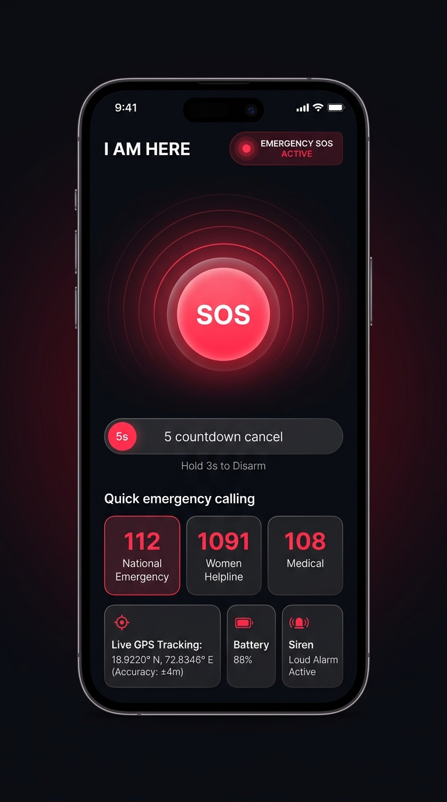
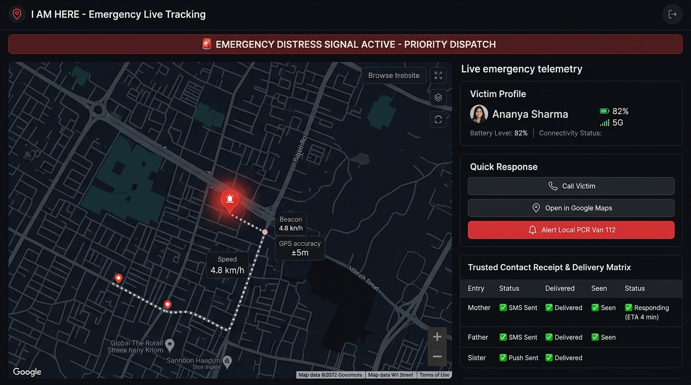
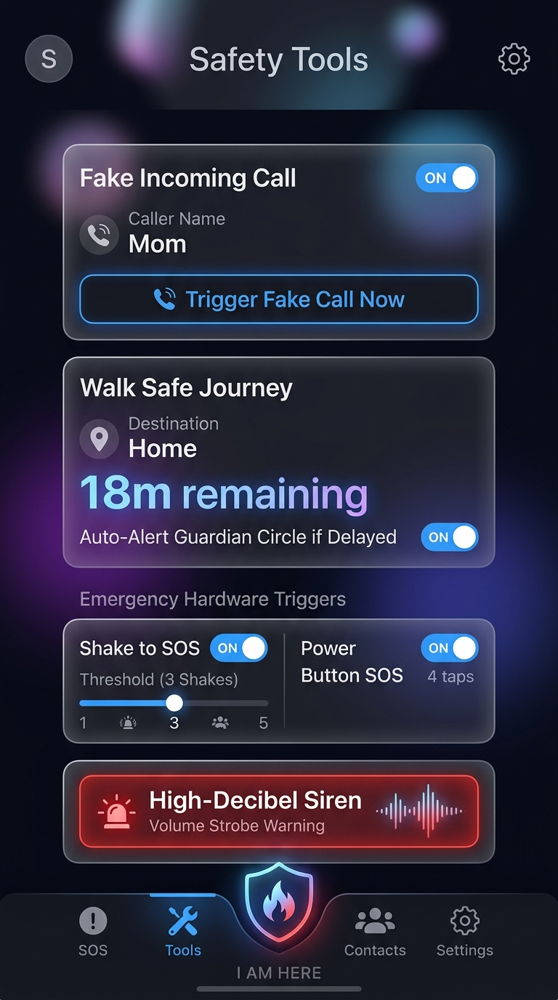
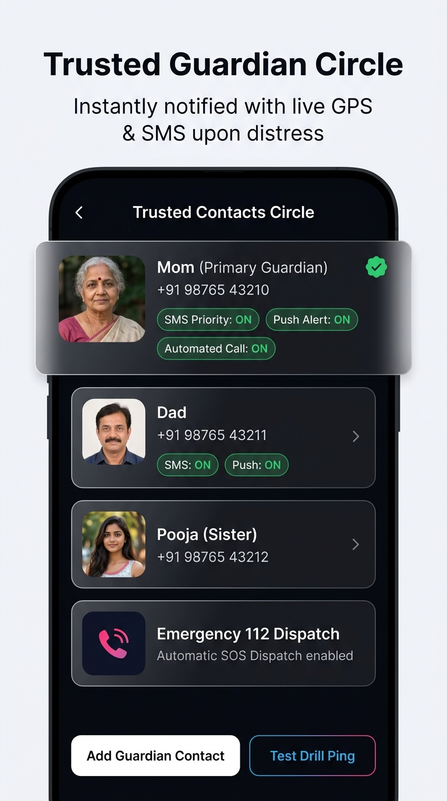
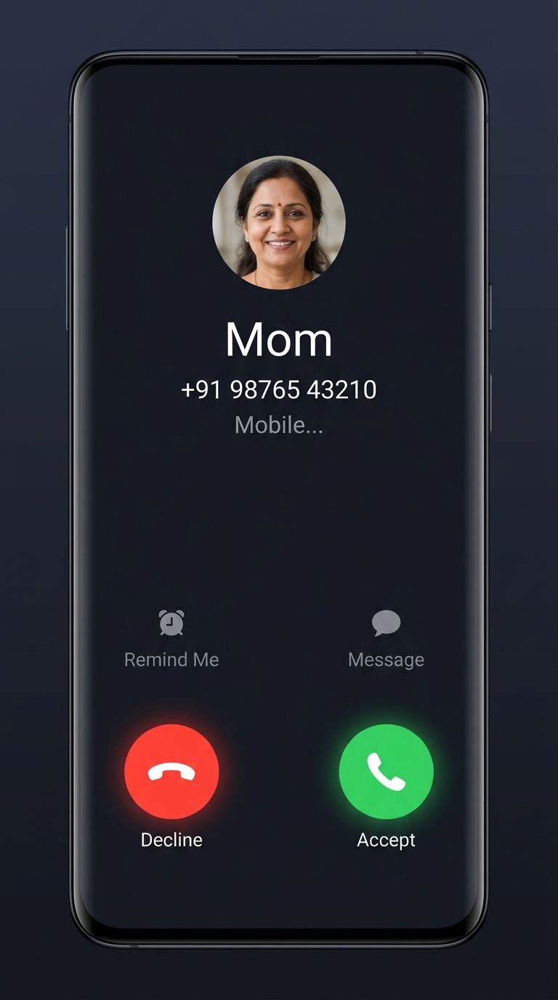

# 🚨 I AM HERE - Women's Safety & Emergency Real-time SOS System

[](https://iamhere-safety.web.app)
[-green?logo=android&style=flat-square)](https://github.com/Action-kamen257/I-AM-HERE)
[-black?logo=apple&style=flat-square)](https://github.com/Action-kamen257/I-AM-HERE)
[](https://github.com/Action-kamen257/I-AM-HERE)
[](LICENSE)

> **I AM HERE** is an enterprise-grade, multi-platform personal safety and emergency SOS ecosystem engineered specifically for women and individuals in vulnerable situations. Built with zero-compromise reliability, sub-second telemetry, physical hardware triggers, and an evidence-backed guardian delivery protocol.

---

## 🌐 Live Deployments & Demos

- **Official Web Portal**: [https://iamhere-safety.web.app](https://iamhere-safety.web.app)
- **Guardian Live Tracking Console**: [https://iamhere-safety.web.app/live?token=demo](https://iamhere-safety.web.app/live?token=demo)
- **GitHub Repository**: [https://github.com/Action-kamen257/I-AM-HERE](https://github.com/Action-kamen257/I-AM-HERE)

---

## 📸 Application Screenshots

### 1. Active Emergency SOS & Panic Interface
Instant single-tap or hardware-triggered distress alert with 5-second cancel buffer, live GPS coordinates, accuracy badge, battery telemetry, and quick shortcuts to 112, 1091, and 108.

<p align="center">
  
</p>

---

### 2. Guardian Live Web Tracking Console
Accessible via instant SMS / Push links sent to trusted contacts. Displays continuous GPS breadcrumb trails on an interactive Leaflet map, battery status, responder actions, and the real-time contact delivery matrix.

<p align="center">
  
</p>

---

### 3. Safety Tools & Hardware Triggers
Configurable emergency hardware triggers including **Triple-Shake accelerometer detection**, **4x Power Button tap detection**, **High-decibel Siren**, and **Walk Safe journey tracking** with automatic time-breach alerts.

<p align="center">
  
</p>

---

### 4. Trusted Guardian Circle & Delivery Evidence Matrix
Multi-tiered emergency contact hierarchy with individual channel toggles (Direct Carrier SMS, High-Priority FCM Push, Automated Voice Call, and Sandbox Drill Pings).

<p align="center">
  
</p>

---

### 5. Discrete Escape Fake Incoming Call Overlay
An ultra-realistic incoming phone call simulator with realistic caller names, avatars, and authentic phone dialer buttons to enable discrete and safe exits from uncomfortable or dangerous social situations.

<p align="center">
  
</p>

---

## 🎯 Critical Product Requirement: Verified Evidence Engine

The trusted emergency-contact pathway is the primary human-response layer. 

> **Golden Rule**: Never show a success state unless the system has verified cryptographic or carrier evidence for that state.

```text
Mother
  ✓ SMS sent
  ✓ Delivered
  ✓ Seen
  ✓ Responding (ETA 4 min)

Father
  ✓ SMS sent
  ✓ Delivered
  ✓ Seen

Sister
  ✓ Push sent
  ✓ Delivered

112 Police CAD
  ✓ Dispatched
  ✓ Acknowledged
```

---

## ⚡ Core Capabilities

- **Multi-Mechanism SOS Activation**:
  - Big glowing on-screen panic button with hold-to-disarm.
  - **Triple-Shake motion detection** using Android accelerometer sensor fusion.
  - **Power-Button tap detection** (4 rapid presses) working in lock-screen state.
  - Quick Settings Status Tile and Android Home Screen Widget.
- **Evidence-Backed Multi-Channel Alerting**:
  - Direct Carrier SMS with live GPS link.
  - High-Priority Firebase Cloud Messaging (FCM) piercing Do-Not-Disturb (DND) where allowed.
  - WebSockets for sub-second guardian synchronization.
- **Offline Location Queue**:
  - If network or cellular connectivity drops, GPS fixes are buffered locally in an encrypted queue and automatically backfilled when connectivity returns.
- **Duress Deactivation PIN**:
  - If an attacker forces the victim to enter a cancellation PIN, entering the alternate **Duress PIN** visually turns off the alarm while silently continuing full live GPS tracking to guardians and dispatchers.
- **Walk Safe Journey Monitoring**:
  - Set a destination and estimated transit time. If arrival isn't confirmed before the countdown expires, emergency alerts trigger automatically.
- **Discrete Fake Call Simulator**:
  - Realistic full-screen incoming call overlay with authentic audio playback.

---

## 🏗️ Architecture & Project Structure

```
I_AM_HERE/
├── android/                   # Android Native Client (Kotlin + Jetpack Compose)
│   ├── app/src/main/
│   │   ├── java/com/iamhere/emergency/
│   │   │   ├── data/          # Offline Location Queue, Repositories, REST API
│   │   │   ├── safety/        # JourneyManager, FakeCallManager, POI locator
│   │   │   ├── sensor/        # ShakeDetector, MotionFeatureExtractor
│   │   │   ├── service/       # LocationForegroundService, TileService, PowerButtonReceiver
│   │   │   └── ui/            # Screens (SosScreen, ContactsScreen, Tools, Theme)
│   │   └── res/               # Android Drawables, Layouts, Strings, Themes
│   └── build.gradle.kts
│
├── backend/                   # Real-time Telemetry Server (Node.js + TypeScript)
│   ├── public/                # Web Tracking Console (live.html, index.html)
│   ├── src/
│   │   ├── app.ts             # Express & WebSocket Core
│   │   ├── push.ts            # FCM Alert Engine
│   │   ├── smsGateway.ts      # Multi-carrier SMS Gateway Relay
│   │   ├── store.ts           # In-memory & Persistent Telemetry Store
│   │   └── types.ts           # Protocol contracts
│   └── package.json
│
├── ios/                       # iOS Native Client (Swift + SwiftUI)
│   └── IAmHere/               # Services, Views, Info.plist
│
├── docs/                      # Store listing, Privacy Policy, Permissions rationales
│   └── screenshots/           # High-resolution application screenshots
│
├── firebase.json              # Firebase Hosting multi-site deployment config
└── README.md                  # Project master documentation
```

---

## 📋 17 Implementation Phase Order

The project roadmap is segmented into sequential, production-tested phase documents:

1. [`00_phase_00__product_and_platform_validation.md`](00_phase_00__product_and_platform_validation.md) - Product & Platform Validation
2. [`01_phase_01__android_foundation.md`](01_phase_01__android_foundation.md) - Android Foundation
3. [`02_phase_02__backend_foundation.md`](02_phase_02__backend_foundation.md) - Backend Foundation
4. [`03_phase_03__first_real_sos_vertical_slice.md`](03_phase_03__first_real_sos_vertical_slice.md) - First Real SOS Vertical Slice
5. [`04_phase_04__strong_trusted_contact_alerts.md`](04_phase_04__strong_trusted_contact_alerts.md) - Strong Trusted Contact Alerts
6. [`05_phase_05__emergency_sms.md`](05_phase_05__emergency_sms.md) - Emergency SMS
7. [`06_phase_06__configurable_live_location.md`](06_phase_06__configurable_live_location.md) - Configurable Live Location
8. [`07_phase_07__lock_screen_and_system_sos.md`](07_phase_07__lock_screen_and_system_sos.md) - Lock Screen and System SOS
9. [`08_phase_08__112_integration.md`](08_phase_08__112_integration.md) - 112 National CAD Integration
10. [`09_phase_09__test_mode_and_failure_engineering.md`](09_phase_09__test_mode_and_failure_engineering.md) - Test Mode & Chaos Engineering
11. [`10_phase_10__motion_and_shake_detection.md`](10_phase_10__motion_and_shake_detection.md) - Motion and Shake Detection
12. [`11_phase_11__trusted_circle_safety_features.md`](11_phase_11__trusted_circle_safety_features.md) - Trusted Circle Safety Features
13. [`12_phase_12__security_and_privacy_hardening.md`](12_phase_12__security_and_privacy_hardening.md) - Security and Privacy Hardening
14. [`13_phase_13__accessibility_and_localization.md`](13_phase_13__accessibility_and_localization.md) - Accessibility and Localization
15. [`14_phase_14__google_play_store_mvp.md`](14_phase_14__google_play_store_mvp.md) - Google Play Store MVP
16. [`15_phase_15__ios_release.md`](15_phase_15__ios_release.md) - iOS Release
17. [`16_phase_16__future_partnerships_and_expansion.md`](16_phase_16__future_partnerships_and_expansion.md) - Partnerships and Expansion

---

## 🚀 Getting Started Locally

### 1. Backend Server & Live Console

```bash
cd backend
npm install
npm run dev
```

Server runs on `http://localhost:3000`. Open `http://localhost:3000/live.html?token=demo` in your browser.

### 2. Android App (Kotlin + Compose)

1. Open the `android/` directory in **Android Studio Hedgehog** (or newer).
2. Connect your device with USB debugging enabled.
3. Verify connection:
   ```bash
   adb devices
   ```
4. Build and install:
   ```bash
   ./gradlew installDebug
   ```

### 3. iOS App (SwiftUI)

1. Open `ios/IAmHere` in **Xcode 15+**.
2. Select target device and press `Cmd + R` to run.

---

## 📞 Emergency Services Reference (India)

| Service | Number | Description |
| :--- | :--- | :--- |
| **National Emergency** | `112` | Unified emergency response (Police, Fire, Medical) |
| **Women Helpline** | `1091` | 24/7 dedicated distress line for women |
| **Ambulance / Medical** | `108` | Emergency medical transportation |
| **Women Power Line** | `1090` | Harassment and safety support |

---

## 🔒 Safety & Training Rule

- If future machine learning is introduced for motion detection or sensor classification, **never automatically start model training**. Prepare and validate the dataset and pipeline, then report that manual training is ready for terminal execution.
- Zero private data or unencrypted credentials shall be exposed to public telemetry.

---

## 📄 License

This project is licensed under the MIT License. See [LICENSE](LICENSE) for details.
